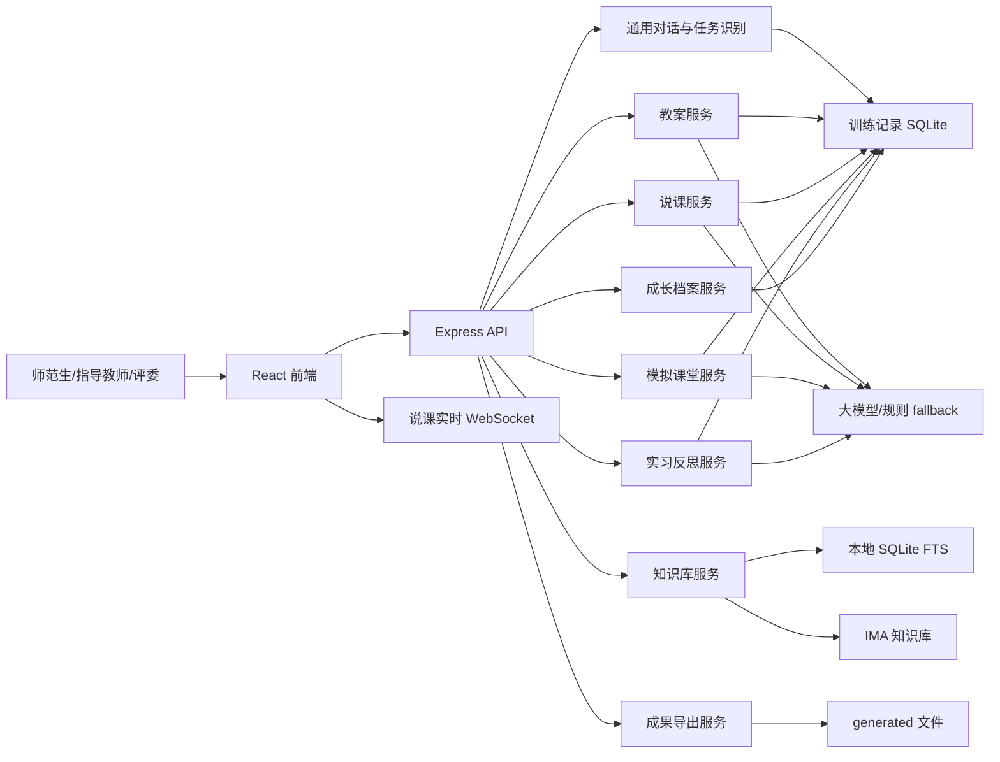
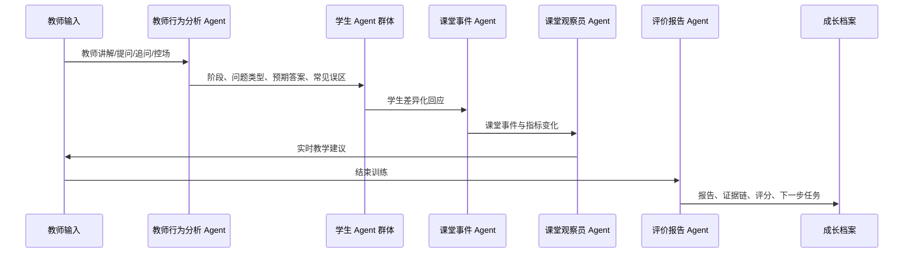

# 易师训设计文档

## 1. 文档目标

本文档描述“易师训”当前系统设计和 2026-07-31 功能冻结前的目标设计，用于指导 AI 辅助开发、模块联调、测试数据生产和国赛演示稳定化。

设计原则：

- 对话即入口，训练即闭环。
- 证据先于结论。
- 多智能体协作必须可解释。
- 单次训练结果进入长期成长档案。
- 易班生态联动以可演示闭环优先。

## 2. 技术栈

前端：

- React 19
- Vite
- TypeScript
- Framer Motion
- lucide-react

后端：

- Node.js
- Express 5
- TypeScript
- WebSocket
- multer
- better-sqlite3

AI 与外部能力：

- Qwen OpenAI-compatible API
- MiniMax 教案生成能力
- Mimo Anthropic-compatible API
- 讯飞 ASR/TTS
- IMA 知识库 OpenAPI
- Langfuse/OTel 可观测能力

存储：

- SQLite 训练记录库：`data/training.db`
- SQLite 知识库：`data/knowledge.db`
- 生成文件目录：`generated/`

## 3. 系统架构



## 4. 前端结构

主要入口：

- `src/main.tsx`
- `src/components/Sidebar.tsx`
- `src/features/classroom/ClassroomTrainingPage.tsx`

当前页面：

- 新对话：自然语言入口，承载教案和反思等任务卡片。
- 说课训练：`SpeakTrainingRoom`
- 虚拟课堂：`ClassroomTrainingPage`
- 智能体看板：`AgentDashboard`
- 知识库：`KnowledgeCenter`
- 历史记录：`HistoryCenter`
- 成长报告：`GrowthCenter`
- 教案中心：`LessonPlanCenter`

前端状态设计：

- `activeSection` 控制当前页面。
- 对话消息持有生成状态、附件、引用、评价、教案状态、反思状态和说课状态。
- 成长档案、历史记录、知识库在进入页面或相关训练完成后刷新。

设计要求：

- 所有核心模块都要提供加载态、空态、错误态。
- 训练完成后应提示下一步动作。
- 演示数据按钮只出现在智能体看板或演示相关区域。
- 页面文案应突出训练闭环和证据链，不写成普通 AI 问答。

## 5. 后端结构

主要入口：

- `server/index.ts`

核心服务：

- `lessonPlanService.ts`：教案生成、诊断、优化、导出构造。
- `speakTrainingService.ts`：说课阶段追踪、追问、答辩、报告。
- `classroom/classroomService.ts`：模拟课堂编排。
- `internshipReflectionService.ts`：实习反思生成、诊断、优化。
- `knowledgeService.ts`：本地知识库和 IMA 知识库聚合。
- `storage/chatRepository.ts`：训练记录、评价、成长摘要。
- `artifactService.ts`：Markdown、Word、PPTX 文件生成。
- `observability.ts`：操作观测与评分记录。

外部模型客户端：

- `qwenOpenAiClient.ts`
- `minimaxLessonPlanClient.ts`
- `mimoAnthropicClient.ts`
- `xfyunSpeechService.ts`

## 6. API 设计

### 6.1 健康检查

- `GET /api/health`

用途：确认后端服务可用。

### 6.2 通用对话

- `POST /api/chat/stream`

用途：

- 支持自然语言训练入口。
- 支持附件上传。
- 支持知识库引用。
- 支持流式返回。

### 6.3 训练记录与评价

- `GET /api/conversations`
- `GET /api/conversations/:id`
- `POST /api/evaluations`

用途：

- 保存和查看历史训练。
- 为已有训练生成评价。

### 6.4 成长档案

- `GET /api/growth/summary`
- `POST /api/growth/report`
- `POST /api/demo/seed-agent-records`

用途：

- 汇总四类训练记录。
- 导出成长档案。
- 生成演示数据。

### 6.5 教案

- `POST /api/lesson-plans/generate`
- `POST /api/lesson-plans/refine`
- `POST /api/lesson-plans/export`

用途：

- 生成教案。
- 按诊断建议优化。
- 导出成果。

### 6.6 实习反思

- `POST /api/internship-reflections/generate`
- `POST /api/internship-reflections/refine`
- `POST /api/internship-reflections/export`

用途：

- 基于实习证据生成反思。
- 优化反思。
- 导出成果。

### 6.7 知识库

- `GET /api/knowledge/providers`
- `POST /api/knowledge/providers/ima/test`
- `POST /api/knowledge/providers/ima/sync`
- `GET /api/knowledge/bases`
- `POST /api/knowledge/bases`
- `GET /api/knowledge/bases/:id/documents`
- `POST /api/knowledge/bases/:id/documents`
- `DELETE /api/knowledge/bases/:baseId/documents/:documentId`
- `GET /api/knowledge/documents/:id/chunks`
- `POST /api/knowledge/search`

用途：

- 管理本地知识库。
- 同步和测试 IMA 知识库。
- 提供 RAG 引用。

### 6.8 说课训练

- `GET /api/speak-training/config`
- `POST /api/speak-training/oralize-material`
- `POST /api/speak-training/blackboard-draft`
- `POST /api/speak-training/turn`
- `POST /api/speak-training/answer`
- `POST /api/speak-training/tts`
- `WS /api/speak-training/realtime`

用途：

- 处理说课片段。
- 将备考参考素材转化为可确认的口语化候选稿。
- 根据教师选定的板书模板生成可编辑的板书结构初稿与课堂书写路径。
- 回答追问。
- 语音合成。
- 实时说课训练。

### 6.9 模拟课堂

- `POST /api/classroom/create`
- `POST /api/classroom/teacher-speak`
- `POST /api/classroom/action`
- `POST /api/classroom/report`

用途：

- 创建虚拟课堂。
- 处理教师发言。
- 执行课堂操作。
- 生成课堂报告。

### 6.10 文件下载

- `GET /api/files/:id`

用途：

- 下载导出的 Markdown、Word、PPTX 文件。

## 7. 数据设计

### 7.1 训练记录

核心表：

- `conversations`
- `conversation_messages`
- `conversation_artifacts`
- `conversation_citations`
- `training_evaluations`
- `speak_training_sessions`
- `growth_snapshots`

核心对象：

- `ConversationSummary`
- `ConversationDetail`
- `TrainingEvaluation`
- `StoredArtifact`
- `StoredCitation`
- `GrowthSummary`

设计要求：

- 每次训练都要保存 conversation。
- 每次评价都要保存 training_evaluation。
- 成果文件保存 artifact。
- 知识库引用保存 citation。
- 成长档案从历史记录聚合，不作为单次训练替代品。

### 7.2 知识库

核心表：

- `knowledge_bases`
- `knowledge_documents`
- `knowledge_chunks`
- `knowledge_chunks_fts`

设计要求：

- 文件上传后先提取文本。
- 文本切分为 chunk。
- chunk 写入普通表和 FTS 表。
- 检索结果返回片段、文档、知识库和 score。

### 7.3 模拟课堂状态

核心类型：

- `ClassroomState`
- `StudentAgent`
- `ClassroomMetrics`
- `ClassroomTimelineItem`
- `ClassroomEvent`
- `ClassroomReport`

状态字段：

- 课堂配置：subject、grade、topic、classType、trainingGoal、difficulty、specialTrainingMode。
- 学生画像：type、level、personality、behaviorTendency、knowledgeFoundation、participationWillingness、misconception、emotionState。
- 课堂指标：participation、understanding、discipline、progress、interactionQuality、goalAchievement。
- 时间线：教师、学生、观察员、系统事件。
- 事件：wrong_answer、no_response、off_topic、time_risk、discipline_issue。
- Agent 统计：teacherAnalyzerRuns、studentAgentActivations、eventAgentTriggers、observerAgentTips、reportAgentRuns。

设计改进要求：

- 7 月 31 日前应提升状态恢复能力，至少保证演示流程不因刷新完全不可继续。
- 课堂报告生成后必须保存到训练记录。

## 8. Agent 设计

### 8.1 总体编排



### 8.2 教师行为分析 Agent

职责：

- 判断教师发言类型。
- 判断课堂阶段。
- 提取问题关键词。
- 构造预期答案框架。
- 判断清晰度、具体性和难度。

输入：

- 教师文本。
- 当前课堂状态。

输出：

- `TeacherActionAnalysis`

风险：

- 关键词规则可能误判追问和反馈。
- 自由文本过短时难以识别意图。

优化方向：

- 增加典型说法词典。
- 为演示课题补充分数、责任、函数、古诗等学科关键词。

### 8.3 学生 Agent 群体

职责：

- 根据学生画像生成差异化回应。
- 体现学霸、基础薄弱、沉默、调皮、误解等类型。
- 更新学生状态和记忆。

输入：

- `ClassroomState`
- 教师文本。
- 教师行为分析。
- 学生画像。

输出：

- `StudentReaction[]`
- 更新后的学生状态。
- 更新后的课堂指标。

风险：

- LLM 输出可能不贴题。
- 规则回答可能模板化。

优化方向：

- 强化回答校验。
- 保证 fallback 也贴合课题。
- 每次回答绑定 topicKeywords 和 expectedPoints。

### 8.4 课堂事件 Agent

职责：

- 捕捉错误答案。
- 捕捉无人回应。
- 捕捉跑题。
- 捕捉纪律问题。
- 捕捉进度风险。
- 判断教师后续动作是否处理事件。

输入：

- 课堂状态。
- 教师行为。
- 学生反应。
- 课堂指标。

输出：

- `ClassroomEvent[]`

风险：

- 单纯关键词判断导致误判。

优化方向：

- 结合事件类型、教师行为和学生反应综合判断。
- 为每类事件提供演示触发样例和处理样例。

### 8.5 课堂观察员 Agent

职责：

- 根据指标和事件给出实时建议。
- 建议必须短、具体、可执行。

输入：

- 当前课堂状态。
- 教师行为。
- 学生反应。
- 新事件。

输出：

- `observerTips`

优化方向：

- 避免重复建议。
- 建议绑定具体事件。

### 8.6 评价报告 Agent

职责：

- 汇总评分。
- 生成事件复盘。
- 抽取证据链。
- 输出 Agent 协作过程。
- 输出下一轮训练任务。

输入：

- 完整课堂状态。
- 可选 LLM insight。

输出：

- `ClassroomReport`

验收要求：

- 至少 3 条证据链。
- 至少 4 个评分维度。
- 至少 1 条下一轮任务。

### 8.7 说课角色 Agent

角色：

- 研究员 Agent：关注课程标准、理论依据、目标合理性。
- 教研员 Agent：关注教学设计、课堂活动和评价闭环。
- 专家 Agent：关注答辩风险、逻辑严谨性和比赛表达。

输出：

- 阶段评价。
- 追问。
- 答辩题。
- 评分和改进建议。

### 8.8 成长档案 Agent

职责：

- 聚合四类训练数据。
- 识别薄弱维度。
- 生成能力矩阵。
- 生成代表成果。
- 推荐下一步任务。

输入：

- 历史 conversation。
- training_evaluations。
- artifacts。
- citations。

输出：

- `GrowthSummary`

## 9. RAG 设计

知识库来源：

- 本地上传资料。
- IMA 知识库。
- 后续易班优课资料。

流程：

1. 用户上传资料。
2. 后端提取文本。
3. 文本按 chunkSize 和 overlap 切分。
4. 写入 SQLite FTS。
5. 训练任务构造搜索 query。
6. 知识库返回 topK citations。
7. 生成服务将 citations 注入提示或规则上下文。
8. 评价和成长档案保存 citations。

设计要求：

- 引用必须展示来源文档。
- 无引用时要明确提示“未引用知识库资料”。
- 不能把 RAG 伪装成真实易班优课接入，状态必须标明本地演示或预留接入。

## 10. 成果导出设计

导出类型：

- Markdown
- Word docx
- PPTX 预留

导出对象：

- 教案。
- 实习反思。
- 成长档案。
- 课堂观察记录或训练报告。

文件生成流程：

1. 服务构造 `ArtifactRequest`。
2. `artifactService` 生成文件。
3. 文件写入 `generated/`。
4. artifact 元数据保存到训练记录。
5. 前端通过 `/api/files/:id` 下载。

验收要求：

- 导出文件可打开。
- 文件名包含项目或训练主题。
- 导出失败有明确提示。

## 11. 易班生态设计

### 11.1 易班优课

当前定位：

- 本地演示或 IMA/知识库资源入口。

设计：

- 将课程标准、优秀课例、教师教育资料作为知识库来源。
- 教案、说课和反思生成时展示引用。
- 成长档案中展示“易班优课资源支撑训练”。

### 11.2 易班实践

当前定位：

- 成长档案导出和实践过程留痕。

设计：

- 将训练记录汇总为实践记录。
- 成长档案模拟同步实践学分或实践证明。
- 展示训练次数、成果、评分和改进任务。

### 11.3 易班社群

当前定位：

- 优秀成果展示和互评入口。

设计：

- 展示优秀教案、说课片段、实习反思。
- 预留社群互评字段。
- 用于网络育人传播。

## 12. 可观测与调试

现有能力：

- `observeOperation`
- `recordTrainingEvaluationScores`
- `recordClassroomMetricScores`
- `recordClassroomReportScores`
- Langfuse 配置。

设计要求：

- 核心训练接口记录输入摘要和输出摘要。
- 不记录完整敏感数据。
- 模拟课堂记录 Agent 运行次数和关键输出。
- 测试数据表从真实运行结果整理。

## 13. 错误处理设计

通用策略：

- 模型不可用时提供规则 fallback。
- 知识库不可用时允许继续训练，但标明无引用。
- 文件解析失败时返回明确错误。
- 语音服务不可用时降级为文字输入。
- IMA 未配置时状态显示 `not_configured`。

模拟课堂策略：

- 学生 LLM 回答未通过校验时回退规则答案。
- 课堂 session 不存在时提示重新生成课堂。
- 报告生成失败时保留课堂状态，允许重试。

## 14. 测试设计

### 14.1 构建测试

命令：

```bash
npm run build
```

验收：

- TypeScript 编译通过。
- Vite 构建通过。

### 14.2 接口测试

核心接口：

- `/api/health`
- `/api/knowledge/bases`
- `/api/lesson-plans/generate`
- `/api/speak-training/turn`
- `/api/classroom/create`
- `/api/classroom/teacher-speak`
- `/api/classroom/report`
- `/api/internship-reflections/generate`
- `/api/growth/summary`

### 14.3 主流程测试

测试链路：

1. 创建知识库并上传资料。
2. 生成教案并优化。
3. 完成说课训练和追问。
4. 创建虚拟课堂并完成 5 轮互动。
5. 生成课堂报告。
6. 生成实习反思。
7. 查看成长档案。
8. 查看智能体看板。
9. 导出成长档案。

### 14.4 测试数据表字段

建议字段：

- 编号
- 日期
- 模块
- 学科
- 年级
- 课题
- 输入摘要
- 知识库引用数
- 生成耗时
- 输出摘要
- 总分
- 主要薄弱项
- 导出是否成功
- 是否进入成长档案
- 问题记录
- 结论

### 14.5 测试覆盖目标

- 教案：5 组。
- 说课：5 组。
- 模拟课堂：5 组。
- 实习反思：5 组。
- 完整链路：2 组。

## 15. 部署设计

本地开发：

```bash
npm install
npm run dev
```

生产构建：

```bash
npm run build
```

环境变量：

- 使用 `.env.example` 作为提交模板。
- 本地 `.env` 不得提交。
- 国赛演示环境需要提前配置模型、IMA、讯飞和 Langfuse 所需变量。

提交包要求：

- 包含源码。
- 包含 `.env.example`。
- 不包含 `.env`。
- 不包含无关 node_modules。
- 包含启动说明。
- 包含测试账号和访问地址。

## 16. 安全设计

必须遵守：

- 不提交真实 API Key。
- 不在测试数据中出现真实学生隐私。
- 上传资料仅用于演示知识库。
- 演示账号使用测试数据。
- 对外展示时隐藏内部密钥、数据库路径和服务日志敏感内容。

## 17. 7 月 31 日功能冻结标准

冻结条件：

- `npm run build` 通过。
- 四大训练模块均可完整跑通。
- 模拟课堂可稳定演示。
- 成长档案可导出。
- 智能体看板有数据。
- 易班生态联动可展示。
- 测试数据不少于 20 组。
- 完整链路至少跑通 2 次。
- 无阻断级 bug。
- `.env` 已从提交包排除。

冻结后规则：

- 不新增大功能。
- 只修复致命 bug、明显错别字、演示阻断问题。
- 数据库、演示数据和生成文件做版本备份。

## 18. 后续扩展方向

国赛后可扩展：

- 教师端班级管理。
- 多用户登录与权限。
- 真实易班平台 API 深度接入。
- 更多学科模板。
- 更完整的学习分析。
- 部署到云端并支持多人试用。
- 长期跟踪师范生微格教学与教育实习表现。
